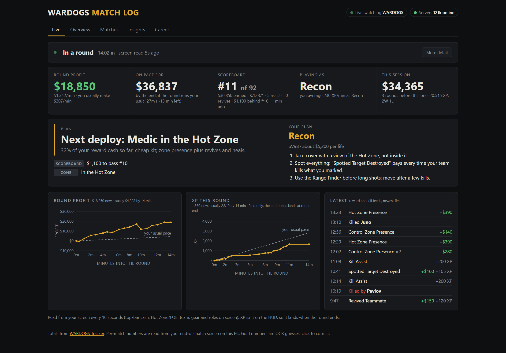
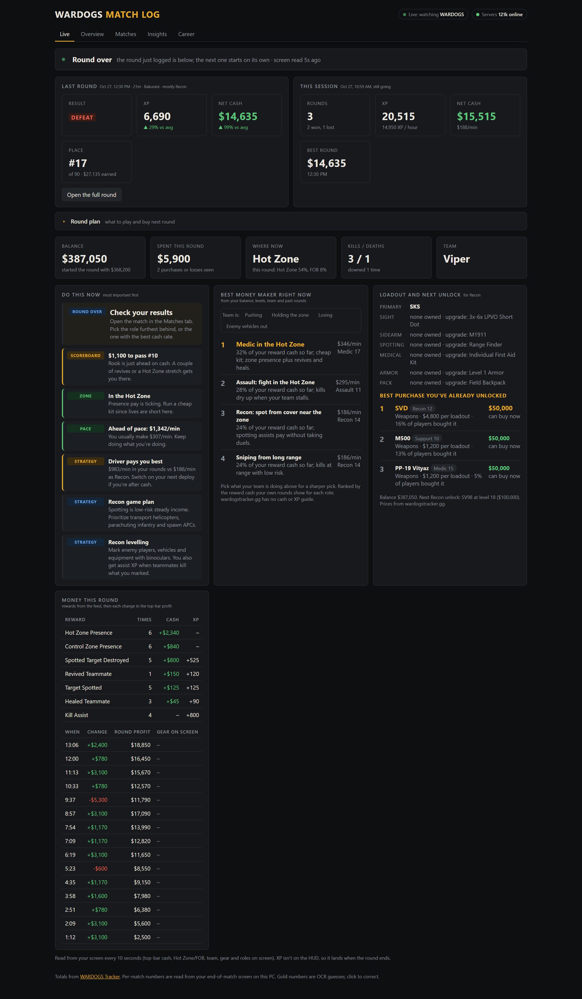
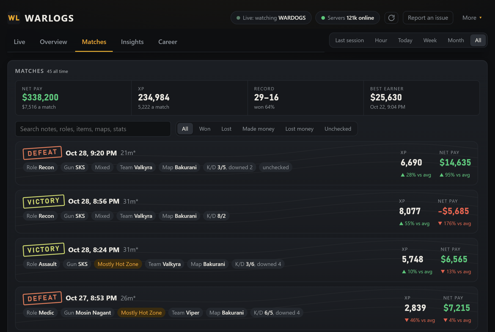
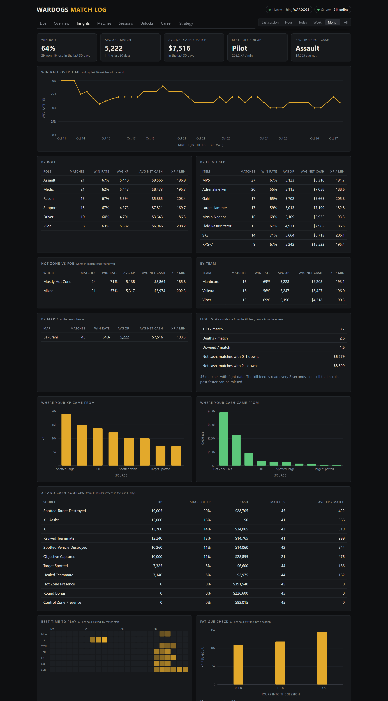

# WARDOGS Match Tracker

Free, local XP and cash tracker for [WARDOGS](https://store.steampowered.com/app/1867240/) on Windows.

- **Logs every round automatically**: XP, cash earned and spent, win/loss, map, role, gun, K/D
- **Live view** for your second monitor: round profit, $/min vs your usual, scoreboard place
- **Match pages**: where your money came from, what you spent it on, a timeline of the round
  and each team's final score
- **History** that shows which roles and guns actually pay off for you
- **Replay map** (experimental): scrub through a round and watch where you went

It reads the screen like OBS does and never changes the game or its files. Everything stays on your PC.



| Between rounds | Matches | Insights |
|---|---|---|
|  |  |  |

<sub>Screenshots are from demo mode, which fills in sample matches so you can see every screen before you've played. Try it yourself: `py -3 demo.py`.</sub>

## Setup

1. [Download the ZIP](https://github.com/bc1224/WARLOGS/archive/refs/heads/main.zip) and unzip it anywhere.
2. Double-click **`Setup.bat`**. It finds Python (or installs it), suggests your Steam ID and
   name ([why it needs them](#is-it-safe)), then starts the tracker and opens the dashboard.
3. Set WARDOGS to **Borderless** or **Windowed** fullscreen and play.

The tracker starts with Windows. Open the dashboard from **WARDOGS Dashboard** in the Start
menu (or `Open Dashboard.vbs` in the folder): it opens in its own window with no tabs or address
bar, using Edge or Chrome's app mode, and starts the tracker first if it isn't running. While the
tracker is running, the dashboard is also at http://127.0.0.1:8790 in any browser (that address
means "this PC", so it only works on the PC running the tracker).

**Updates:** when a new version is out, the dashboard shows an Update button. It downloads
the new files from this repo, checks that each one is exactly what GitHub lists, keeps your
settings and match log, and restarts the tracker. Nothing updates unless you click it, or turn
on **Install updates automatically** under **More**: then new versions install on their own
while you're not in a game. A git clone updates with `git pull` instead.

<details>
<summary>Using Claude Code, Codex or another AI agent? Paste this instead.</summary>

```text
Set up the WARDOGS Match Tracker from https://github.com/bc1224/WARLOGS on this Windows PC: clone it into my Documents folder, follow its AGENTS.md, ask me for anything it can't detect, and tell me when the dashboard is open.
```

</details>

<details>
<summary>Manual setup and uninstall</summary>

Install Python 3.10+, copy `config.example.json` to `config.json`, fill in your SteamID64
and in-game name, then run `Start Tracker.vbs`.

To uninstall, run this in the folder, then delete the folder. It stops the tracker and removes the Start menu and
Startup shortcuts. (`-ExecutionPolicy Bypass` only lets this one script run; it doesn't change
any Windows setting.)

```powershell
powershell -ExecutionPolicy Bypass -File setup.ps1 -Uninstall
```

</details>

## Is it safe?

The game process is never opened, read, injected or hooked, and none of its files are read. The tracker only:

- checks the process list to see if WARDOGS is running (like Task Manager)
- copies pixels from the screen while WARDOGS is in front (like OBS). It keeps the latest 150
  frames (about 20 MB) and recent minimap pictures for the replay map in its own `data` folder,
  and deletes older ones as it goes
- reads (never writes) your Steam screenshots folder for WARDOGS. Steam's own **F12**
  screenshot key is an optional backup: if a round wasn't logged, press F12 on the results
  screen and the tracker reads that picture. It doesn't take Steam screenshots itself, so that
  folder only grows when you press F12
- only if you turn on **Stats from wardogstracker.gg**: asks that fan site's public
  [API](https://wardogstracker.gg/developers) for your lifetime totals, unlocks and rank. Off on a
  new install
- asks GitHub every few hours whether a newer version is out (sends nothing about you; switch
  off **Check for updates** to stop it)
- sends a report only when you click **Report an issue** and press Send: your text, the
  screenshot you added and the app version go to a small relay (`relay/`) that files them as a
  public GitHub issue. Nothing else from your PC is sent

**Your Steam ID and name.** Setup reads the file where Steam lists the accounts that have signed
in on this PC (`Steam\config\loginusers.vdf`: account numbers and names, no passwords) to
suggest your Steam ID and name, and you confirm or change them. Both stay in `config.json` on
your PC:

- the **Steam ID** is how the tracker looks up your profile on wardogstracker.gg, if you turn
  that on. It only finds anything if you've synced your profile on their site
- your **in-game name** is how it spots your own kills and deaths in the kill feed and your row
  on the scoreboard

No password or login is ever asked for or read.

**What each switch does.** They're under **More** at the top of the dashboard:

| Switch | On | Off |
|---|---|---|
| Stats from wardogstracker.gg (starts off) | Sends your Steam ID there every 15 minutes or so for lifetime level and XP, unlocks, rank, item prices and server status | Nothing about you goes there |
| Check for updates (starts on) | Asks GitHub every few hours if there's a new version; sends nothing about you | No Update button; download again to update |
| Install updates automatically (starts off) | Installs new versions between games and restarts the tracker | You click Update when one shows |

Each match logs from your screen either way, with its XP and cash. With the first two off,
nothing leaves your PC unless you send a report.

**What it writes and where it connects.** It only writes inside its own folder: `config.json`
and the `data` folder (match log, recent frames, `tracker.log`). Setup also adds the Start menu
and Startup shortcuts, and if you say yes, installs Python with winget. The only places it
connects to:

| Address | When |
|---|---|
| `wardogstracker.gg` | Only with **Stats from wardogstracker.gg** on |
| `api.github.com`, `codeload.github.com` | Checking for and downloading updates, with **Check for updates** on |
| `wardogs-report-relay.bcf1224.workers.dev` | Only when you press Send in **Report an issue** |

The dashboard only answers on your own PC (127.0.0.1), refuses requests from other websites,
and only runs its own scripts.

It's light: about 150 MB of RAM, no GPU.

**Ban risk.** The WARDOGS [terms](https://www.wardogs.com/eula) forbid "unauthorised third-party
software", and the developers haven't approved or reviewed this tracker. It never touches the
game or sends input, which is what anti-cheat looks for, but that isn't permission. Use it at
your own risk.

## Troubleshooting

| Problem | Fix |
|---|---|
| "capture was blank" | Switch WARDOGS to Borderless or Windowed fullscreen. |
| A match wasn't logged | Press **Ctrl+Alt+E** on the results screen. Check `data/tracker.log`. |
| A wrong match was logged | Click **not a match** on the dashboard. |
| Something else is wrong | Click **Report an issue** at the top of the dashboard, add a screenshot, and send it. |
| Stop the tracker | End `pythonw.exe` in Task Manager. Remove the Startup shortcut to stop autostart. |

## More

- [How it works](docs/HOW-IT-WORKS.md): every tab, what gets read and when, and where your data lives
- Tests: `py -3 -m unittest discover -s tests -t .`; UI check (needs Playwright): `py -3 tests/ui_smoke.py`. Both run in GitHub Actions (QA) on every push and PR
- Not affiliated with the WARDOGS developers or wardogstracker.gg
- MIT license
